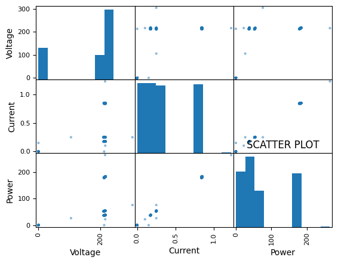
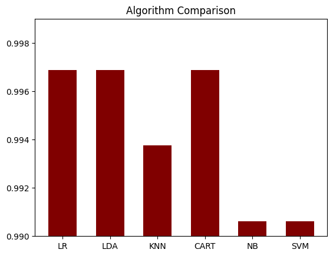

# Energy Meter Classification

**Author:** Mohammed Adeen Shaik  
**Review date:** 11 October 2026

## Research question

How do six classification algorithms compare on the recorded energy-meter sample?

## Data and provenance

Historical notebook outputs from 400 energy-meter observations; the source CSV is not included.

Source materials are linked from the repository README. Input fingerprints are recorded in [the evidence manifest](evidence.json) so a reader can identify the exact committed artifacts used in this review.

## Method and analytical rationale

Voltage, current and power are used as predictors. The notebook first demonstrates an SVM split and then compares six algorithms through ten-fold stratified cross-validation on a separate training partition.

## Findings and interpretation

Historical saved notebook outputs, **not a fresh rerun**. Ten-fold cross-validation on the 320-row training partition reports LR, LDA and CART at 0.996875 mean accuracy, KNN at 0.993750, and NB and SVM at 0.990625. The separate SVM holdout demonstration reports 0.985 accuracy on a different 50% split. Differences this small on a 400-row sample do not establish a reliable winning algorithm.

| Algorithm | Mean fold accuracy | Fold standard deviation |
|---|---:|---:|
| LR | 0.996875 | 0.009375 |
| LDA | 0.996875 | 0.009375 |
| KNN | 0.993750 | 0.018750 |
| CART | 0.996875 | 0.009375 |
| NB | 0.990625 | 0.020010 |
| SVM | 0.990625 | 0.020010 |

## Limitations

The first SVM holdout and later cross-validation use different partitions and cannot be mixed into one benchmark. Repeated NoLoad observations may inflate row-level validation. Fold standard deviations are not confidence intervals. The data must be supplied before rerunning.

## Reproduction

Use the setup commands and input contract in the [repository README](https://github.com/Adeen1607/ML-algorithms-comparison#readme). Open the [notebook catalogue](notebooks.html) for annotated code and saved outputs. Keep raw records and model binaries local; public reports contain aggregate results or source-embedded figures.

## Final visual results

*Figure from ML Algorithm comparison .ipynb, original code cell 21.*

*Figure from ML Algorithm comparison .ipynb, original code cell 21.*

*Figure from ML Algorithm comparison .ipynb, original code cell 31.*

